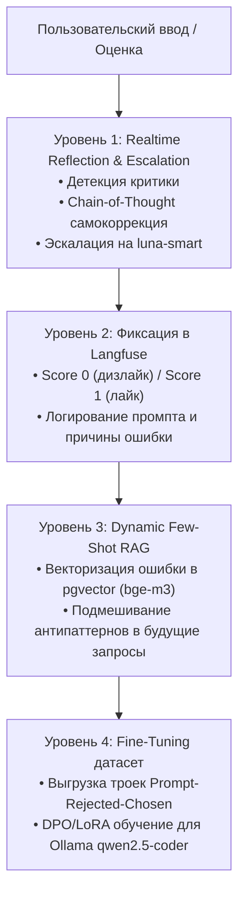

# 🏛 Архитектура LunaGPT v2.0

## 1. Концепция и продуктовая ценность

**LunaGPT** — суверенная персональная ИИ-лаборатория и интеллектуальный шлюз с логической маршрутизацией запросов, локальным выполнением задач на GPU AMD Radeon RX 580 (8 ГБ VRAM, $0/токен) и 100% аудитом в **Langfuse**.

Система решает проблему фрагментированного использования ИИ, объединяя:
1. **AI-разработку и агентов в IDE** (Continue в VS Code, Antigravity, Aider, CLI-агенты через OpenAI-совместимый эндпоинт `:4000/v1`).
2. **Личный чат и веб-доступ** (Open WebUI, мобильный доступ через Tailscale).
3. **Корпоративную память и базу знаний (RAG)** с парсингом документов через Docling и векторным хранилищем `pgvector` с локальными мультиязычными эмбеддингами `bge-m3`.
4. **Замкнутый контур самообучения (Active Learning Flywheel)** на основе оценок и правок пользователя.

---

## 2. Диаграмма архитектуры системы

```text
┌────────────────────────────────────────────────────────────────────────┐
│                               КЛИЕНТЫ                                  │
│  • Open WebUI (Веб-чат на ПК и смартфоне через Tailscale :3000)        │
│  • VS Code / Continue / Antigravity / CLI-агенты (:4000/v1)            │
│  • LunaGPT Core REST API (:8010/v1)                                    │
└───────────────────────────────────┬────────────────────────────────────┘
                                    │
                                    ▼
┌────────────────────────────────────────────────────────────────────────┐
│                   LunaGPT Gateway (LiteLLM Proxy :4000)                │
│  • Интеллектуальный роутинг моделей и агентов                          │
│  • Отказоустойчивость (Failover) и балансировка нагрузки               │
│  • Redis-кэширование семантики и ограничение частоты запросов          │
│  • Langfuse v2 Compatibility Logger (/api/public/ingestion)            │
│                                                                        │
│  Виртуальные модели:                                                   │
│   ├── luna-smart → Anthropic Claude Sonnet 4.6 (Флагманский интеллект) │
│   ├── luna-fast  → Google Gemini 3.5 Flash Lite (Сверхбыстро, 1M+ ctx) │
│   ├── luna-pro   → Anthropic Claude Opus 4.6 (Архитектура и аудит)     │
│   ├── luna-coder → Ollama (qwen2.5-coder:7b на AMD RX 580 GPU, $0)     │
│   ├── luna-embed → Ollama bge-m3 (Мультиязычные эмбеддинги 1024-dim, $0)│
│   └── luna-auto  → Авто-роутер с каскадной эскалацией                   │
└──────────────────┬─────────────────┬───────────────────┬───────────────┘
                   │                 │                   │
                   ▼                 ▼                   ▼
    ┌──────────────────────┐  ┌─────────────┐  ┌─────────────────────────┐
    │     OLLAMA HOST      │  │ CLOUD APIS  │  │   LANGFUSE SERVER :3001 │
    │ • GPU RX 580 (8 ГБ)  │  │ • Gemini    │  │ • Трейсинг диалогов     │
    │ • qwen2.5-coder:7b   │  │ • Anthropic │  │ • Затраты ($) и токены  │
    │ • bge-m3:latest      │  │   Claude    │  │ • Оценки и Scores (0/1) │
    └──────────────────────┘  └─────────────┘  └────────────┬────────────┘
                                                            │
                                                            ▼
┌────────────────────────────────────────────────────────────────────────┐
│                      ХРАНИЛИЩЕ И ВЕКТОРНАЯ ПАМЯТЬ                      │
│  • PostgreSQL 17 + pgvector (0.8.7, Port :5433)                        │
│      ├── БД langfuse (Сессии, трейсы, токены, генерации)               │
│      └── БД lunagpt (Векторный RAG документов, feedback_memories)      │
│  • Redis 7.4 (Кэш промптов и сессий LiteLLM, Port :6380)               │
└────────────────────────────────────────────────────────────────────────┘
```

---

## 3. Политика маршрутизации (Routing Policy)

| Модель | Назначение | Провайдер | Стоимость |
| :--- | :--- | :--- | :--- |
| **`luna-smart`** | Универсальный интеллект: аналитика, код, логика (по умолчанию) | Anthropic Claude Sonnet 4.6 | Тариф Anthropic |
| **`luna-fast`** | Большие документы, перевод RU/UZ/EN, суммаризация, фоновые задачи | Google Gemini 3.5 Flash Lite | Доли цента ($) |
| **`luna-pro`** | Долгие рассуждения, системный дизайн, авто-эскалация при критике | Anthropic Claude Opus 4.6 | Тариф Anthropic |
| **`luna-coder`** | Локальные фоновые воркеры, автокомплит и тесты | Локальная **AMD RX 580 (8 ГБ)** | **$0.00** |
| **`luna-embed`** | Индексация документов и RAG базы знаний (1024 dim) | Локальная Ollama (`bge-m3`) | **$0.00** |
| **`luna-auto`** | Авто-выбор с каскадной эскалацией | Smart $\to$ Fast $\to$ Pro | Оптимизированная |

---

## 4. Контур активного обучения и самокоррекции (4 Уровня)



## Luna AI Assistant и HomeSec (актуально на ноябрь 2026)

Две системы с разной ответственностью, чтобы падение одной не останавливало другую.

| Машина | Что работает | Кто пользуется |
|---|---|---|
| Raspberry Pi | HomeSec: AdGuard, квоты, правила MikroTik, панель, бот админа, сетевой API `/api/luna/v1` | Родители |
| ПК с GPU | LunaGPT: шлюз, модели, память, Luna (`src/lunagpt/assistant/`) | Вся семья и гости |

| Отказ | Поведение |
|---|---|
| Pi | Правила на роутере сохраняются, Luna работает, взрослые получают уведомление через 3 минуты |
| ПК | Сеть и квоты работают, Pi отправляет всем участникам сообщение токеном Luna, когда heartbeat молчит 3 минуты |
| Оба | Интернет дома работает, нужен внешний контроль (план) |

Порядок моделей: `luna-local`, затем `luna-fast` (Gemini), затем `luna-smart` (Sonnet). Обоснование: `docs/research/2026-11-luna-assistant-decisions.md`.

Люди и устройства хранятся только на Pi. Владелец подключает человека кнопкой «Семья»: одноразовая ссылка записывает его Telegram на Pi. Каждые 5 минут Luna применяет переименования, смену ролей и удаления, сделанные на Pi. Временные гости создаются кнопкой «Гость». Навигация построена на постоянном меню и inline-кнопках, команды не используются.

Общие устройства (`kind=shared`) имеют три состояния: детский режим, выключено и для взрослых до заданного времени.
